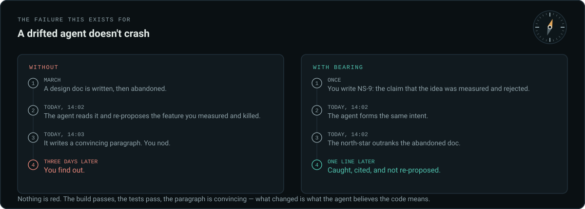
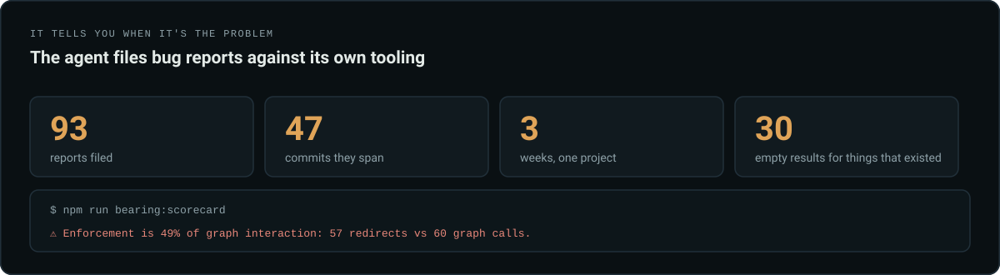
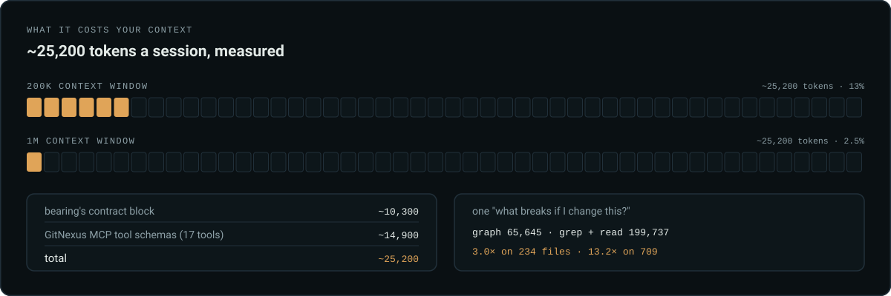
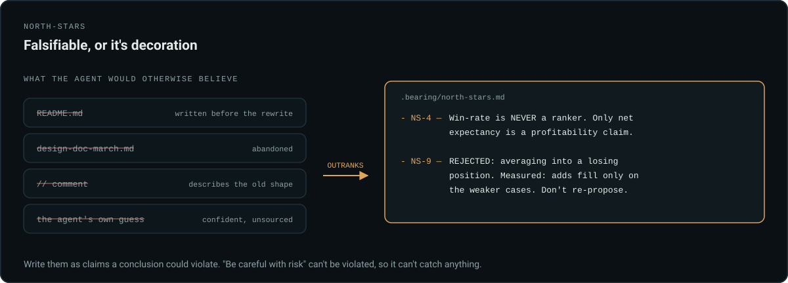
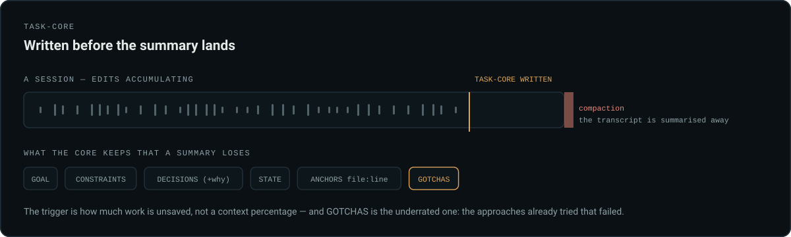
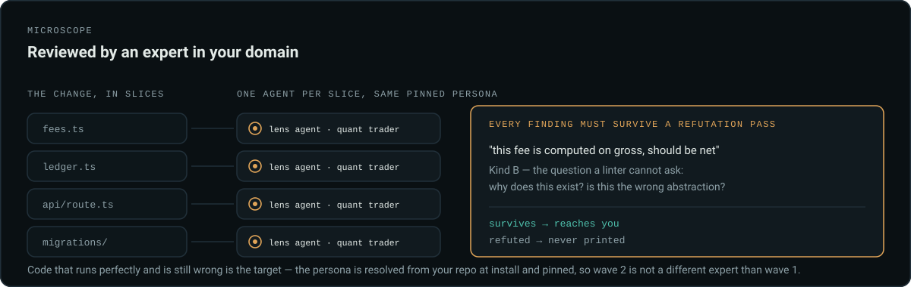
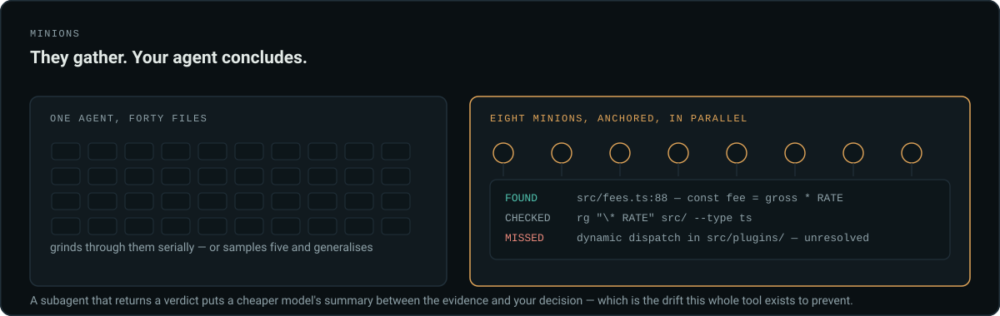
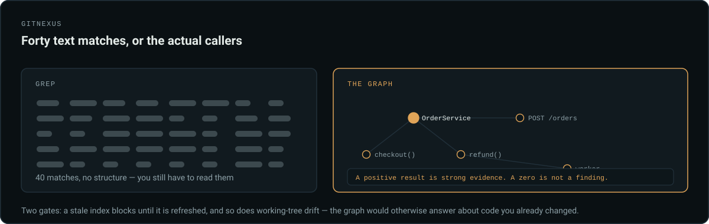

<div align="center">


# bearing

**An intel layer for AI coding agents.**

Your tests catch code that breaks. Nothing catches an agent that has drifted about what the code *means*.

[](https://www.npmjs.com/package/bearing)
[](https://www.npmjs.com/package/bearing)
[](https://nodejs.org/)
[](LICENSE)
[](https://github.com/ReidenXerx/bearing)

**Claude Code** · **Zed** · **Codex**

```bash
npx bearing
```

**[duduphudu.app/bearing](https://duduphudu.app/bearing/)** — what it does, what it costs, and where it fails

</div>



A drifted agent doesn't crash. It reads a doc you abandoned in March, re-proposes the feature you already measured and killed, and writes a convincing paragraph about it. You nod. You find out three days later.

That failure has a name — **losing your bearings**.




**Contributing to a repo that isn't yours?** `npx bearing install . --stealth` keeps `git status` clean — no tracked file is touched. Details under [Install](#install).



**It will not blow up your context.** ~2,800 tokens a session by default (~18,800 with every module and GitNexus) — and one *what breaks if I change this?*
costs 3–13× less through the graph than grepping and reading the hits. Measure it on your own repo
with `npm run bearing:token-benchmark`; [the numbers, and where the graph LOSES](#what-it-costs-your-context).

## What you get

**Twelve independent modules. Pick any combination — each works alone, none depends on another.**
| | |
|---|---|
| ⚑ **North-stars** | **Stops killed ideas respawning six months later.** Numbered, authoritative claims about what your project *is* — **outranks every other doc**, re-injected as the session runs. |
| 🏅 **Gold practices** | **The mistakes that get made anyway.** Numbered `GP-#` rules earned from real defects — a claim from reading rather than running is unverified, a test that has never failed has never been tested. Language- and project-neutral. |
| 💾 **Task-core** | **Survives compaction.** A dense save-state of the current task, written **before** the summary lands and drops the detail. |
| 🔬 **Microscope** | **Catches code that runs perfectly and is still wrong.** Say "microscope this" and a panel of lens agents reviews as an expert in *your* domain — each finding must survive its own refutation pass. |
| 🙋 **Consult** | **Asks about the right things, decides the rest.** Asks you only what isn't in the repo — which reading you meant, what a user should see — as options you click, not a paragraph you write, and decides everything else. Confirms before anything irreversible. |
| 🐜 **Minions** | **Parallelises wide mechanical work, when you say so.** Cheap anchored subagents return **citations, not opinions** — they gather; your agent concludes. Invasive minions do the same for a *decided* change: each applies it to its own slice in an isolated worktree, and your agent reviews every slice before it lands. |
| 🧪 **TS/JS rules** | **Catches code that compiles and is still wrong.** Numbered `TS-#` rules for the traps `tsc` and ESLint both stay silent about — `as` that verifies nothing, a union that falls through on the next variant, `||` overwriting a deliberate `0`. |
| 🧱 **Frontend** | **Stops the near-duplicate component and the silent shared-component edit.** Search by shape before building a table or a panel; an optional prop with a safe default is yours, anything that changes what existing callers render is an ask. |
| ⚛️ **React** | **Catches the form bugs that fail silently.** A field owns its `Controller`; spreading `field` keeps the `ref` that focus-on-error needs; a `name` typed `FieldPath<T>` turns a renamed field into a compile error instead of a value missing from the payload. |
| 🌳 **ast-grep** | **Searches and rewrites by code shape, and proves the pattern first.** Every `fetch` with no `signal`, every swallowed `catch`, a decided change at 100 sites — matched on the syntax tree, not a regex. The skill carries the traps that make it lie quietly: a pattern that does not parse returns `[]` exactly like a clean codebase, `-l ts` skips `.tsx`. Opt-in; uses ast-grep from `PATH` or `npx`, adds nothing to `package.json`. |
| 🕸 **GitNexus** | **A code graph you reach for when you ask.** Opt-in: the installer explains it and asks. Say "use gitnexus" in a prompt and one skill loads — scope check, where the graph wins, where its counts are only a floor. No gates, no nudges. Requires the [GitNexus](https://github.com/abhigyanpatwari/GitNexus) MCP server. |
| 🎭 **E2E** | **Turns "I checked it in the browser" into an exit code.** A harness your agent finishes: working substrate plus the scars, and a way to test a destructive write *without performing it*. Opt-in — it writes `.e2e/` and needs Playwright. |

**And one thing that isn't a module:** the agent files bug reports against its own tooling, and the kit measures its own rules — it measured its GitNexus gates, found them costing 4–5× for one task's gain, and retired them. → [the receipts](#it-tells-you-when-its-the-problem)

## Install

```bash
npx bearing                                    # interactive — explains each module
npx bearing install . --runtime claude --features northstars,taskcore
```

`--runtime` `claude` · `zed` · `codex` · `all`  ·  `--features` `northstars` · `goldpractices` · `taskcore` · `microscope` · `consult` · `minions` · `tsjs` · `frontend` · `react` · `astgrep` · `gitnexus` · `e2e` · `all`

Then restart your IDE. The moments a module speaks up need tool-interception hooks, and **only
Claude Code** exposes them:

| | Claude Code | Zed | Codex |
|---|:---:|:---:|:---:|
| North-stars — loaded as authority | ✅ | ✅ | ✅ |
| North-stars — re-anchored mid-session | ✅ | — | — |
| Gold practices — cited as authority | ✅ | ✅ | ✅ |
| Task-core — survives compaction | ✅ | — | — |
| Microscope — domain-expert review | on ask | on ask | — |
| Consult — ask vs decide | ✅ | ✅ | — |
| Minions — anchored fan-out | on ask | — | — |
| TypeScript/JavaScript — traps that compile | ✅ | ✅ | ✅ |
| Frontend — structure and blast radius | ✅ | ✅ | ✅ |
| React — what the types do not catch | ✅ | ✅ | ✅ |
| ast-grep — search and rewrite by shape | ✅ | ✅ | ✅ |
| GitNexus — the graph, only when you ask | on ask | on ask | — |
| E2E — browser verification | ✅ | ✅ | ✅ |

✅ means it fires without being asked; *on ask* means it never does, by design, and answers when you ask. A `—` is not always absence: the **task-core** skill and its
contract section install on every runtime, so you can invoke it by name — what Claude Code adds is
the nudge that fires it unprompted. **Minions** need Claude Code's subagents and are not present at all
where the column says `—`. Microscope, minions and GitNexus fire only when you ask, on any runtime that
has their skill.

### 🎨 Prettier — so two tools stop rewriting each other

An install puts up to ~75 tracked, formattable files into your repo — the hook lib alone is 26 `.mjs`
modules — and every one is bearing's, replaced wholesale on the next update. If you format on
commit, Prettier reformats all of them, the next `bearing update` overwrites them back, and that diff
returns every cycle.

If the installer finds Prettier (`.prettierrc*`, `prettier.config.*`, a `prettier` key or
dependency in `package.json`, or just a `.prettierignore`), it **asks** — and quotes back what it
found, since you are being asked to let an installer edit your formatter's config:

```
This repo runs Prettier (found package.json: devDependencies.prettier)
Add 5 bearing-owned paths to .prettierignore?
  1  Yes — stop the two tools rewriting each other's work
  2  No — leave .prettierignore alone (your files, your call)
```

Non-interactive installs decide with `--prettierignore` / `--no-prettierignore`; **saying nothing
means no**, because `.prettierignore` is your repo's configuration and bearing does not edit it
uninvited. The answer is remembered, so an update refreshes the block rather than re-asking, and
`--no-prettierignore` later takes it back out. Only paths bearing **wholly owns** are listed —
`CLAUDE.md` and `AGENTS.md` are yours, so they keep being formatted. Uninstall removes the block,
and deletes the file only if bearing created it.

Stealth installs skip this and say so: `.prettierignore` is a tracked file, and writing it would
break the one promise stealth makes.

### 🥷 Stealth — for repos that aren't yours to change

```bash
npx bearing install . --stealth
```

A normal install is a team decision: it commits hooks, skills, a contract and npm scripts, and
everyone who pulls gets them. That's right for a repo you own and wrong for one you contribute to.

Stealth makes one promise, and it's testable: **`git status` is exactly as clean after the install
as it was before.** No tracked file is modified — not `.gitignore`, not `package.json`, not
`CLAUDE.md`. Ignores go in `.git/info/exclude`, which is per-clone and itself untracked, so the
rules can't travel. The contract is delivered by the session hook instead of a file.

Where a runtime has no per-user channel, bearing says so instead of writing the file anyway. It also
**refuses** to convert a repo where bearing is already committed — un-tracking it for your whole team
is a deliberate, visible act, not something an install flag should do behind your back.

Two things to know: the exclusions live in the clone, so a re-clone doesn't carry the install — run
it again. And uninstall empties only the block it wrote.

---

## ⚑ North-stars

**Docs rot. Comments lie. The agent's own inference fills the gaps.**



Write them as claims a conclusion could actually **violate**:

```markdown
- **NS-4** — Win-rate is NEVER a ranker. Only net expectancy is a profitability claim.
- **NS-9** — REJECTED: averaging into a losing position. Measured: adds fill only on the
             weaker cases. Don't re-propose without new evidence.
```

*"Be careful with risk"* can't be violated, so it can't catch anything. **Falsifiable or it's decoration.**

The graveyard stops ideas respawning six months later. If the agent can't cite a north-star for a load-bearing claim, it says so — that's your drift alarm.

> Built for a codebase where 81 documents had come to contradict each other on live production parameters.

### 🥇 Gold practices — the half that isn't yours

North-stars say what *your project* is. `.bearing/gold-practices.md` ships with bearing and says how
the work is done **anywhere** — numbered `GP-#`, cited the same way, and **outranked by your `NS-#`**
whenever they disagree.

**Every rule has a scar, and a rule without one is not in the file.** Nothing about writing tests or
naming things — you already do that. These are the mistakes that got made *anyway*, by a careful
agent, on this codebase:

> **GP-3 — Test at the seam the bug lives at.** A unit test that passes an argument the real pipeline
> never produces is green and dead. *Scar: a context-window fix tested as `resolve(300_000, undefined)`
> while the shipped config always passed a number — so the fix could not run, and did not, for two
> releases.*

Nineteen of them, and two computed guards keep the list honest: every rule must carry a scar, and
every `GP-#` cited anywhere must still exist. The second caught a dangling citation within minutes of
being written.

---

## 💾 Task-core

**Long sessions get compacted. The transcript is summarized and thrown away.**



Written *before* the summary lands — by then the detail is already gone. The trigger is **how much work is unsaved** (edits since the last write), not a context percentage: the window isn't knowable at runtime, and what makes a compaction expensive is unwritten decisions, not fullness.

It stores what a summary reliably loses: `GOAL · CONSTRAINTS · DECISIONS(+why) · STATE · ANCHORS(file:line) · GOTCHAS`. **GOTCHAS is the underrated one** — the approaches you already tried that failed, so the agent doesn't cheerfully re-attempt them.

## 🔬 Microscope

**Most review asks "is this code correct?" — a question a linter can ask.**

You start it — *"microscope this"*, *"audit before we ship"*, *"is this solid?"* — and nothing starts it for
you: a review panel costs time and tokens, and when to spend them is your call.



It maps your change into slices and spawns **one lens agent per slice** — in parallel where your runtime supports it — each carrying the **same pinned persona**, resolved from your repo at install and stored in `.bearing/domain.json`. A trading repo is reviewed by a quant trader; a payments repo by a ledger engineer. Pinned, so wave 2 can't quietly become a different expert than wave 1.

**Kind B is the part a linter can never do.** It asks *why does this exist?*, *is this the wrong abstraction?* — and catches semantic wrongness: *"this fee is computed on gross, should be net."* Code that runs perfectly and is still wrong.

Then every finding has to survive an adversarial pass that tries to **refute** it. What can't be defended never reaches you.

## 🙋 Consult

**Agents interrupt you for the wrong things, and go quiet for the wrong things.**

Permission to rename a file; silence while they invent a business rule. Consult is the judgment that separates the two, for a senior engineer who does not want to be asked about naming.

**The test that does most of the work: is the answer discoverable in the repo?** Code, tests, config, git history, north-stars — then it goes and finds it, because asking is offloading. If it exists only in *your* head — which of two readings you meant, which tradeoff you prefer, what a user should actually see — no amount of reading produces it. **That** is the question.

And it asks **before** it writes the rule, not after — as options you click, not a question you have to answer in a paragraph: two to four concrete choices, its recommendation first, one line of tradeoff each, and related questions in one prompt so you answer once. Never *"shall I proceed?"* — that is not a question, it is accountability being handed back to you.

**One-way doors are a different act.** Deleting data, force-pushing, publishing, migrating — it *confirms*, even when the right answer is obvious, because irreversible is the reason, not ambiguity. Reversible work needs no permission.

Most answers are just applied. The rare one that is a **rule** — one a future task would otherwise break — gets proposed as a north-star in the same reply, so that question is never asked again.

## 🐜 Minions

**Your agent can already spawn subagents. You say when; minions is how.**



Say *"fan this out"* or *"use minions"* and the skill checks the work first — fan out only when it is **bounded, verifiable, independent and wide** (3+ units), and *say so* when the judgment itself is the work. Nothing fans out unasked: on the eval's 200-file audit, an agent left to itself wrote a script and got it right.

Each subagent carries the same north-stars and pinned persona, and returns evidence in a fixed shape:

```
FOUND    src/fees.ts:88 — const fee = gross * RATE
CHECKED  rg "\* RATE" src/ --type ts
MISSED   dynamic dispatch in src/plugins/ — could not resolve
```

### Invasive minions — the same shape, for a change you already decided

The same blindness costs more when the work is a **write**: forty files edited by hand, every edit
identical in shape, while the only thing that needed thinking — what the change should be — was
settled before the first one. Logging coverage, an error envelope, the rest of a settled migration.

**A gathering minion must not decide what is TRUE; an invasive one must not decide what to CHANGE.**
So the four gates hold, plus two: the transformation is **decided in full** beforehand, and each
minion works **isolated** — its own git worktree, or a patch file — so nothing it writes reaches your
tree until your agent has reviewed that slice. `node .bearing/lib/minion-review.mjs` does the
mechanical half: it rejects a slice that touched a file outside its list, or no longer applies
because another slice already changed the same lines. That used to be a silent lost update. Whether
every hunk matches the brief stays your agent's call, and only then does the slice land, uncommitted
and reversible on its own.

```
SLICE    handlers-orders — branch minion/handlers-orders
WROTE    src/routes/orders.ts:41 — log.info({ orderId, userId }, "order.created")
VERIFIED tsc --noEmit src/routes/orders.ts → 0
SKIPPED  src/routes/legacy.ts:12 — handler returns a stream; brief covers no such shape
```

`SKIPPED` is the reason to reach for it. Three minions skipping the same shape means your
specification had a hole — where a single agent would have quietly decided nine times and you would
find out, if ever, in review.

And the brief is worth writing **even when you do not fan out**: it survives compaction, it keeps
site 30 consistent with site 3, and one you cannot write is a change you have not finished thinking
about.

**Minions gather. Your agent concludes — they do minimal or zero reasoning.** A subagent that returns a *verdict* puts a cheaper model's summary between the evidence and your decision, which is the drift this whole tool exists to prevent.

That `CHECKED`/`FOUND` split is load-bearing: `CHECKED` filled and `FOUND` empty means *it looked and there was nothing*. Both empty means *it never understood the task*. In prose those are the same sentence.

## 🕸 GitNexus

**Grepping a symbol gives 40 text matches and no structure.**



**Opt-in, and you invoke it.** It is not in the default install: the installer explains what it is, what it costs (the `gitnexus` CLI, an index build, a local MCP server) and when it helps, and asks. Once installed, nothing pushes the agent towards it — no gates, no nudges, no always-on instructions. Ask for it in a prompt ("use gitnexus to find what this diff affects") and the `bearing-gitnexus` skill loads: check scope first (the index is one checkout at one commit), where the graph wins, and where its counts are only a floor.

It used to be graph-first by force: hooks that blocked greps and reads. A 180-run eval on a fixture with hand-verified answers measured it at 4–5× the cost per solved task for one task's gain, and a teaching-moments replacement almost never fired — so both were retired ([the report](eval/teaching/REPORT.md)). On a large repo, for the questions text search answers badly, the graph still earns its keep; that is what the skill is for.

**A coverage limit presented as a fact is the failure this is built to survive.** `impact` can return zero callers for a function wired to a live route, because calls through factories and DI seams don't always resolve. So the contract is asymmetric, and the agent is told so:

> **A positive result is strong evidence. A zero is not a finding.** Never conclude "dead code" from an empty graph result — confirm it classically and say which check you ran.

When `impact` grades a change `risk: LOW` but resolved *no* callers, the kit says so before you edit. It warns rather than blocks — re-running returns the same empty answer.

## 🎭 E2E harness

Opt-in: it is the one module off by default, because it writes a new top-level `.e2e/` and wants a
Playwright download. `--features …,e2e`, or pick it in the wizard.

Not a test framework — Playwright is the capability, and your agent already has it. What it ships is
the **shape and the scars**: a report whose exit code is the product, polling waits instead of
sleeps, request readers that assert on the *body* because a 2xx can carry an error envelope, and
`blockWrites` — intercept a mutation, capture the payload, fulfil it locally, so "does this button
send the right thing" stops being an irreversible experiment.

Screenshots are keyed by *what they are of*, not by filename. The next capture of a view replaces
it, so a directory of shots is always current and never accumulates `editor-final-2.png`. It
catalogues itself.

The harness is meant to **grow**. When a verifier hits something the kit handled badly, the agent
appends it to the scars list and fixes it at the next milestone — not mid-run, because results from
a harness that no longer exists are not results.

Every scar in the shipped README is one that produced a **green run over a real failure**: a skip
stored as a pass turning an all-skipped run into a pass, a URL pattern that matched the list instead
of the create, a blanket POST block that severed the session and made a working feature look missing.

## 🤖 PR impact report — when you want one

With the GitNexus module, `npm run bearing:ci -- <base>` reports a branch's blast radius per changed symbol, affected flows, security-sensitive paths and import cycles. Run inside a GitHub Actions pull-request job it also posts a sticky PR comment. bearing ships no workflow for it — nothing builds or refreshes the index on a trigger — so wire it into your own CI only if you keep an index there. It **never fails your build** by default: the graph can't distinguish "nothing calls this" from "I couldn't resolve the callers", and a hard block on that fails honest PRs. `GITNEXUS_CI_MODE=block` is opt-in.

## 🧮 What it costs your context

The honest number, measured rather than guessed.

**Fixed, every session:**

| | tokens |
| --- | --- |
| bearing's contract block (`CLAUDE.md` / `AGENTS.md`), default install | ~2,800 |
| … with every module | ~3,900 |
| GitNexus MCP tool schemas (17 tools) — only if you install GitNexus | ~14,900 |

The default install is **~1.4% of a 200k window**; every module plus GitNexus is ~18,800, **~9%**.
Skills are loaded on demand, not up front — a session typically pulls one or two, at ~1,500 tokens
each; `bearing-gitnexus` is ~5,800, and loads only when you ask for the graph.

The contract used to be ~10,300 tokens, most of it graph commandments every session paid for. Those
moved into the opt-in skill when the gates were retired (NS-25).

The second row is not bearing's — those are the graph tool definitions, present whenever the MCP
server is connected, with or without this package. And bearing's own share scales with what you
install:

```
all modules             ~3,900 tokens
default install         ~2,800
north-stars + task-core ~1,400
```

**What it buys back.** Answering `what breaks if I change this?` through the graph, against
grepping and then reading what grep points at. Two graph numbers, because they answer two different
questions — `--summary-only` gives counts and risk, the full response gives every call site, which
is what `git grep` gives you:

```
                             summary    sites   grep+read   vs sum   vs sites
  lead-sniffer (234 files)    10,505   65,645     199,737     19x        3.0x
  Sourcerer-Be (709 files)     7,534   71,446     945,338    125x       13.2x
```

**`vs sites` is the honest column** — like for like. The 19x/125x figures compare a summary against
grep's locations, which flatters the graph by however much the call-site list would have cost. Both
are real questions; pick the row that matches the one you were going to ask.

Repaid inside one to two questions either way.

**Do not take my repos for it — measure yours:**

```bash
npm run bearing:token-benchmark          # or: -- --targets 12 --json
```

It picks your most-called symbols, runs the real `impact` against them, and compares that with
`git grep` plus a 40-line window around every hit — which is what answering by hand actually costs.
It reports losses too: on lead-sniffer the graph loses one of eight, and says so in the table. A
symbol with three callers is cheaper to grep, and a benchmark that never admits that is advertising.

<sub>Token figures are estimated at 3.7 chars/token — a calibration constant, not a tokenizer. Assume ±10%.</sub>

## It tells you when it's the problem

Every enforcement tool believes its own rules are correct. This one assumes they might not be, and keeps the evidence.

```bash
npm run bearing:fallback -- "impact returned 0 callers for OrderService but grep finds 3"
```

The reason is captured **with the graph state that produced it** — version, node/edge counts, indexed commit. Not "the graph was wrong once", but *this query, on this index, at this commit*.

One real project accumulated **93 reports across 47 commits in three weeks**. Read together they stopped being complaints and became a diagnosis: 30 were empty results for things that demonstrably existed. That corpus is what the rules above are calibrated against.

Its own rules get measured too. The GitNexus gates were: across a fleet of real repos they produced one redirect for every graph call, and a 180-run eval with hand-verified answer keys put them at 4–5× the cost per solved task for one task's gain. So they were retired, and the graph became opt-in — the verdict and the numbers are in [`eval/teaching/REPORT.md`](eval/teaching/REPORT.md).

Nothing leaves your repo. There is no telemetry endpoint.

*A tool that asks to steer your agent should be able to show you when it was wrong to — and stop.*

## Commands

```bash
npx bearing install <repo> [--runtime ...] [--features ...] [--mcp http|stdio|<port>] [--stealth] [--prettierignore]
npx bearing update <repo>       # keeps your module + transport choices
npx bearing uninstall <repo>    # restores what it overwrote
```

With the GitNexus module: `bearing:northstars` · `bearing:health` · `bearing:refresh` · `bearing:fallback-log` · `bearing:scorecard` · `bearing:verify` · `bearing:token-benchmark`

**Requirements:** Node ≥ 22.9.0 · a git repo · macOS, Linux, Windows or WSL · *(GitNexus module only)* the GitNexus MCP server.

[Quickstart](docs/QUICKSTART.md) · [Skills](docs/SKILLS.md) · [Architecture](docs/ARCHITECTURE.md) · [Zed + local models](docs/ZED.md) · [Changelog](https://github.com/ReidenXerx/bearing/blob/main/CHANGELOG.md) · [Releases](https://github.com/ReidenXerx/bearing/releases)

## License

ISC
