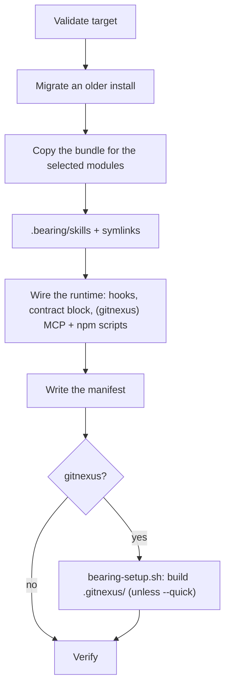

# Architecture

bearing installs an **intel layer** into a repository: a contract the agent reads every session, skills it loads on demand, and — on Claude Code — a few hooks that raise the right prompt at the right moment. It is built from independent modules; you pick which ones a repo gets.

GitNexus is one of those modules, and an opt-in one. bearing used to be built around it — gates that blocked grep and reads until the agent used the graph. That was measured and retired: the gates cost 4–5× per solved task for one task's gain ([`eval/teaching/REPORT.md`](../eval/teaching/REPORT.md)). The graph is now something you ask for.

## The failure it targets: semantic drift

Tests catch code that breaks. They do not catch an agent that has read a stale doc, adopted a premise you abandoned, and carried it through every conclusion after — fluently, confidently, and without erroring. The work is wrong and nothing is red.

| Module | Failure it closes | Mechanism |
| --- | --- | --- |
| **north-stars** | "which source is authoritative?" — docs contradict each other and the agent picks whichever it read last | A user-owned, numbered, *falsifiable* statement of the project that **outranks every other source**. Agents cite `NS-#`; a conflicting doc is declared stale, not averaged in. Re-anchored as the session runs and right after a doc is written. |
| **gold practices** | the mistakes careful agents make anyway | Numbered `GP-#` rules earned from real defects, plus the project's own `PP-#` rules below a marker that updates never touch. |
| **task-core** | compaction drops the goal, the decisions, and what was already tried | A dense save-state written **before** the summary lands and read back first on recovery, one file per chat. |
| **microscope** | "it runs" reviewed as "it's right" | Adopts the expert role the project implies, reviews through several lenses, and refutes each finding before reporting it. |
| **consult** | asking about everything, or deciding what only the user can | Asks only what is not in the repo; decides the rest; confirms before anything irreversible. |
| **minions** | wide mechanical work ground through serially | Cheap anchored subagents on the middle tier gather citations — or apply a decided change, each in its own worktree, with every slice reviewed before it lands; the main agent concludes. |

Precedence is the load-bearing idea: north-stars outrank every other doc, the code outranks prose for facts, and a conflict is reported rather than silently resolved.

The remaining modules are rule packs and tools: **tsjs**, **frontend** and **react** (numbered rules for code that type-checks and is still wrong), **astgrep** (search and rewrite by code shape, with the pattern proven first), **history** (git history as evidence for why code is this way), **knip** (unused code, told apart from code that only looks unused), **gitnexus** (the code graph, when you ask), and **e2e** (a browser verification harness).

## Two independent axes

Installation resolves the **runtime** (which agent) and the **modules** (which capabilities) independently.

```
runtime:  claude · zed · codex · all        (or a comma list)
modules:  northstars · goldpractices · taskcore · microscope · consult · minions
          tsjs · frontend · react · astgrep · history · knip · gitnexus · e2e · all
```

The default install is the first six modules. `lib/features.mjs` maps every bundle file to the module that owns it; unclaimed files are **core** and always ship. One rule keeps this honest: **a core file may never import a module's file** — otherwise a module's absence breaks core. It is computed, not hand-maintained (`coreLibClosure()` walks the real import graph), because the hand-written list broke twice.

Only Claude Code exposes tool-interception hooks, so only there do the nudges fire by themselves. Zed and Codex get the same contract through `AGENTS.md`. None of the hooks blocks a tool call.

## What lands in a repository

| Path | What it is | Owned by |
| --- | --- | --- |
| `CLAUDE.md` / `AGENTS.md` (bearing block) | The always-on contract, filtered to the installed modules. Everything outside the block is yours. | core |
| `.bearing/northstars.md` | Your north-stars. Seeded once with a starter, never overwritten. | north-stars |
| `.bearing/gold-practices.md` | `GP-#` rules (refreshed on update) and your `PP-#` rules below the END marker (never touched). | gold practices |
| `.bearing/task-cores/` | One save-state per chat. | task-core |
| `.bearing/skills/` | The canonical skill store, symlinked into `.claude/skills/` and/or `.agents/skills/`. | per module |
| `.bearing/lib/` | The libraries the hooks and scripts load. | per module |
| `.bearing/hooks.json` | Team-shared hook tuning. Seeded once; `hooks.local.json` overrides it per machine. | core |
| `.bearing/manifest.json` | What was installed, so update and uninstall touch only that. Gitignored. | core |
| `.claude/settings.json` | The hook registrations (Claude Code). Your own hooks in it are kept. | core |
| `.mcp.json`, `.zed/settings.json` | The gitnexus MCP server. A committed command or transport is kept. | gitnexus |
| `scripts/`, `bearing:*` npm scripts | Health, verify, refresh, PR helpers. | gitnexus |
| `.gitnexusignore` | What enters the graph. Seeded once; your rules below the managed block survive updates. | gitnexus |
| `.e2e/` | The browser harness. | e2e |

A **stealth** install (`--stealth`) writes none of the tracked files: ignores go in `.git/info/exclude`, the contract is injected per session instead of written to `CLAUDE.md`, and no npm scripts are added.

## Hooks (Claude Code)

| Hook | Event | What it does | Knob (off) |
| --- | --- | --- | --- |
| `bearing-session` | SessionStart | Resets per-session state and injects the brief: north-stars, the task-core path, memory. | `sessionBrief: false` |
| `bearing-northstar-anchor` | PostToolUse | Re-anchors the agent on the north-stars as the context grows, and on the relevant ones after a doc is written. | `northStarAnchorEvery: 0` |
| `bearing-taskcore-nudge` | PostToolUse | Asks for a task-core refresh once enough unsaved work has piled up. | `taskCoreEveryEdits: 0` |
| `bearing-consult-nudge` | PostToolUse | Poses the ask-or-decide test at the first edit. **Off by default**: `consultNudge: true`, then `bearing update`. | `consultNudge: false` |
| `bearing-precompact` | PreCompact | Counts the compaction. Says nothing. | — |
| `bearing-impact-audit` | PostToolUse on `impact` (GitNexus) | Annotates an `impact` result whose caller count may only be a floor. | `impactAudit: false` |

Knobs go in `.bearing/hooks.json` (team, committed) or `.bearing/hooks.local.json` (this machine; it wins).
`bearing status` prints each one with its current value and how often it fired in the last 30 days.

Each is registered only when its module is installed, runs on every matching tool call and so stays cheap, and fails open: a hook that errors says nothing rather than getting in the way.

## Install, update, uninstall



- **Migration runs before the copy**, and inspects the bundle rather than the target, so it can tell what an older version left behind from what this one ships. An update removes what older versions installed and this one retired: hooks and their registrations, libraries, skills and their links, npm scripts, the tool-less Zed profile, and the pre-commit index refresh with its two CI workflows (unsetting `core.hooksPath` when it pointed at the hook bearing removed).
- **Install and update are idempotent**: a second run changes nothing.
- **Removal is manifest-driven**: only what bearing recorded as its own is taken back. Seed-once files (`northstars.md`, `hooks.json`, `.gitnexusignore`) are written on the first install and never overwritten; a `northstars.md` you have written in survives uninstall.
- **Your choices are inherited**: runtime, modules, MCP transport and the gitnexus binary are read back from the manifest — or, for the MCP entry, from your committed `.mcp.json`, which outranks a single machine's preference.

## The GitNexus module

Opt-in: the interactive installer explains it and asks, or `--features +gitnexus`. Installed, it pushes nothing — no always-on instructions, no gates, no nudges. Ask for it in a prompt and the `bearing-gitnexus` skill loads. It covers:

- **Scope first.** The index is one checkout at one commit. `node .bearing/lib/index-scope.mjs` says whether this session's checkout is the indexed one — a linked worktree or another branch is not.
- **Where the graph wins**: blast radius of a plain call, `detect_changes` before a commit, `rename` dry-runs, structural questions (overrides, N-hop paths, field readers and writers via Cypher `ACCESSES`).
- **Where its counts are only a floor**: JSX components, object-literal properties, injected receivers, callbacks, ORM columns — each with the grep that confirms it.
- **Reading its uncertainty**: `epistemic`, `boundaries`, edge confidence, and that a zero is not absence.

Nothing refreshes the index on its own — no commit hook, no CI job. A refresh can take minutes on a large repo, so it runs when the developer asks: in a chat ("refresh the gitnexus index"; the skill runs `bearing-agent.mjs refresh`, which diagnoses first and does the least that closes the gap) or with `npm run bearing:agent-refresh`. The install builds the first index unless `--quick`.

When the graph is wrong, `npm run bearing:fallback -- "…"` files a report with the graph state that produced it (version, node and edge counts, indexed commit). Nothing leaves the repository.

## Bundle layout

```
bundle/
├── .bearing/        lib/ (hook and script libraries), lang/, stack/, northstars.md, gold-practices.md, hooks.json
├── .claude/hooks/   the Claude Code hooks
├── skills/          the canonical skill store (copied to .bearing/skills)
├── templates/       the contract (CLAUDE.gitnexus.md / AGENTS.gitnexus.md) and the status line
├── scripts/         setup, verify, the agent CLI, refresh helpers (gitnexus)
├── docs/            team guides shipped with the gitnexus module
├── .e2e/            the browser harness (e2e)
└── .gitnexusignore
```

Templates use `__GITNEXUS_REPO__`, substituted with the repository name at install time. The contract templates are generated from `scripts/contract/` (`npm run gen:contract`).
