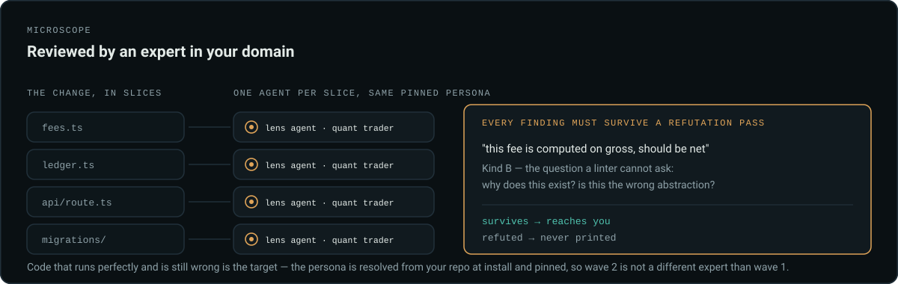

# 🔬 Microscope

**Most review asks "is this code correct?" — a question a linter can ask.**

You start it — *"microscope this"*, *"audit before we ship"*, *"is this solid?"* — and nothing starts it for
you: a review panel costs time and tokens, and when to spend them is your call.

It maps your change into slices and spawns **one lens agent per slice** — in parallel where your runtime supports it — each carrying the **same pinned persona**, resolved from your repo at install and stored in `.bearing/domain.json`. A trading repo is reviewed by a quant trader; a payments repo by a ledger engineer. Pinned, so wave 2 can't quietly become a different expert than wave 1.

**Kind B is the part a linter can never do.** It asks *why does this exist?*, *is this the wrong abstraction?* — and catches semantic wrongness: *"this fee is computed on gross, should be net."* Code that runs perfectly and is still wrong.

Then every finding has to survive an adversarial pass that tries to **refute** it. What can't be defended never reaches you.

---

[← back to the README](../../README.md)
