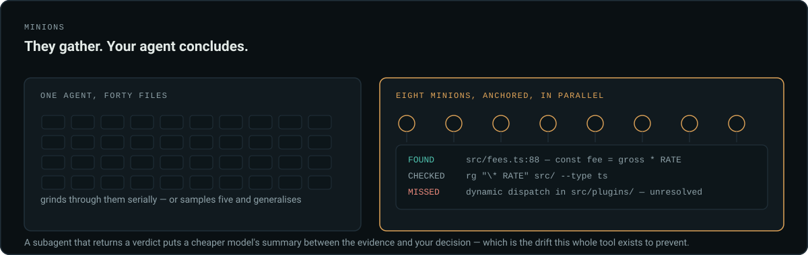

# 🐜 Minions

**Your agent can already spawn subagents. You say when; minions is how.**



Say *"fan this out"* or *"use minions"* and the skill checks the work first — fan out only when it is **bounded, verifiable, independent and wide** (3+ units), and *say so* when the judgment itself is the work. Nothing fans out unasked: on the eval's 200-file audit, an agent left to itself wrote a script and got it right.

Each subagent carries the same north-stars and pinned persona, and returns evidence in a fixed shape:

```
FOUND    src/fees.ts:88 — const fee = gross * RATE
CHECKED  rg "\* RATE" src/ --type ts
MISSED   dynamic dispatch in src/plugins/ — could not resolve
```

## Invasive minions — the same shape, for a change you already decided

The same blindness costs more when the work is a **write**: forty files edited by hand, every edit
identical in shape, while the only thing that needed thinking — what the change should be — was
settled before the first one. Logging coverage, an error envelope, the rest of a settled migration.

**A gathering minion must not decide what is TRUE; an invasive one must not decide what to CHANGE.**
So the four gates hold, plus two: the transformation is **decided in full** beforehand, and each
minion works **isolated** — its own git worktree, or a patch file — so nothing it writes reaches your
tree until your agent has reviewed that slice. `node .bearing/lib/minion-review.mjs` does the
mechanical half: it rejects a slice that touched a file outside its list, or no longer applies
because another slice already changed the same lines. That used to be a silent lost update. Whether
every hunk matches the brief stays your agent's call, and only then does the slice land, uncommitted
and reversible on its own.

```
SLICE    handlers-orders — branch minion/handlers-orders
WROTE    src/routes/orders.ts:41 — log.info({ orderId, userId }, "order.created")
VERIFIED tsc --noEmit src/routes/orders.ts → 0
SKIPPED  src/routes/legacy.ts:12 — handler returns a stream; brief covers no such shape
```

`SKIPPED` is the reason to reach for it. Three minions skipping the same shape means your
specification had a hole — where a single agent would have quietly decided nine times and you would
find out, if ever, in review.

And the brief is worth writing **even when you do not fan out**: it survives compaction, it keeps
site 30 consistent with site 3, and one you cannot write is a change you have not finished thinking
about.

**Minions gather. Your agent concludes — they do minimal or zero reasoning.** A subagent that returns a *verdict* puts a cheaper model's summary between the evidence and your decision, which is the drift this whole tool exists to prevent.

That `CHECKED`/`FOUND` split is load-bearing: `CHECKED` filled and `FOUND` empty means *it looked and there was nothing*. Both empty means *it never understood the task*. In prose those are the same sentence.

---

[← back to the README](../../README.md)
