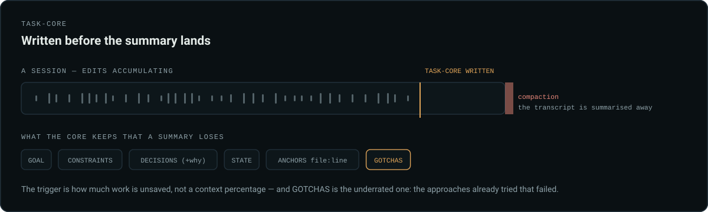

# 💾 Task-core

**Long sessions get compacted. The transcript is summarized and thrown away.**

Written *before* the summary lands — by then the detail is already gone. The trigger is **how much work is unsaved** (edits since the last write), not a context percentage: the window isn't knowable at runtime, and what makes a compaction expensive is unwritten decisions, not fullness.

It stores what a summary reliably loses: `GOAL · CONSTRAINTS · DECISIONS(+why) · STATE · ANCHORS(file:line) · GOTCHAS`. **GOTCHAS is the underrated one** — the approaches you already tried that failed, so the agent doesn't cheerfully re-attempt them.

---

[← back to the README](../../README.md)
