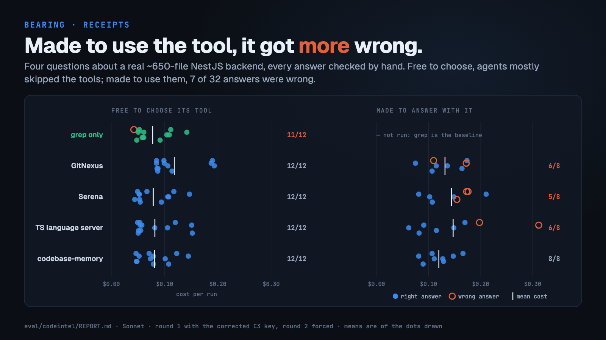

# Code intelligence on a real repository — GitNexus vs Serena vs the rest

**Question.** On a real TypeScript backend, does a code-intelligence tool make an agent more right
than grep, and which one is right when it is used?

**Repository.** A private NestJS + TypeORM backend, about 650 JS/TS files. Nothing from it is
committed here: the targets live in a hand-verified key outside this repository, the prompts are
built at run time, and raw rows stay in `~/.cache/bearing-eval/codeintel/`.

**Conditions** (`eval/codeintel/run.mjs`). Each condition gets the same `git archive` slot and the same
prompt, plus one neutral line naming its tool, under `--strict-mcp-config`:

| | Tool | Version | Tools offered | Index |
| --- | --- | --- | --- | --- |
| none | grep, reading files | — | — | — |
| gitnexus | GitNexus MCP | 1.6.12-rc.21 | 17 (~69k chars of schema) | `analyze`, built before the runs |
| serena | Serena, `--context claude-code` | 2.1.0 | **2**: `initial_instructions`, `serena_repl` | per session |
| lsp | Claude Code `typescript-lsp` plugin | 1.0.0 + typescript-language-server 5.1.3 | the `LSP` tool | per session |
| cbm | codebase-memory-mcp | 0.12.1 | 17 | `index_repository`, built before the runs |

Every session recorded its MCP servers as `connected` and listed its tool, so a tool that went unused
was available and was not chosen.

**Tasks and keys.** Every key was read site by site; none was written by a tool (NS-27).

| | Question | Key | Built to separate |
| --- | --- | --- | --- |
| C1 | every call site of a method on a class reached through constructor injection | 18 sites: 14 through injected fields in four workers, 4 `this.` calls | DI resolution, the known blind spot of syntax-only graphs |
| C2 | which public methods of that class are never called | **none**: every one is called, and one only through `app.get(Class)` in the bootstrap file | a tool blind to a call path reports live code dead, and that answer becomes a deletion |
| C3 | which classes implement an interface | 2 | a control |
| C4 | which call sites must change if a helper gains a required parameter | 15, across `src/` and `scripts/`; a comment mentions the call | plain imports, where graphs are strong; the comment is a trap for text search |

The graders are tested in CI on a synthetic key. Each one passes the key and fails the predictable
wrong answers.

## Round 1: the agent may use its tool (3 trials, 60 runs, $5.61)

| | none | gitnexus | serena | lsp | cbm |
| --- | --- | --- | --- | --- | --- |
| C1 | 3/3 | 3/3 | 3/3 | 3/3 | 3/3 |
| C2 | 3/3 | 3/3 | 3/3 | 3/3 | 3/3 |
| C3 (corrected key, 15 runs, $0.94) | 2/3 | 3/3 | 3/3 | 3/3 | 3/3 |
| C4 | 3/3 | 3/3 | 3/3 | 3/3 | 3/3 |
| runs that used the tool | — | **9/12** | **0/12** | **0/12** | 2/12 |
| mean cost per run | $0.091 | $0.123 | $0.082 | $0.087 | $0.085 |

**Grep alone answered every question.** That includes all 18 DI call sites and the bootstrap-only
method. Given a choice, agents used GitNexus most of the time, at **+35% cost** with no gain. They
used codebase-memory twice, and never touched Serena or the language server.

## Round 2: the agent must answer with its tool (2 trials, 32 runs, $4.34)

| | gitnexus | serena | lsp | cbm |
| --- | --- | --- | --- | --- |
| C1 | 2/2 | 1/2 (2/2*) | 2/2 | 2/2 |
| C2 | **0/2** | **1/2** | **0/2** | 2/2 |
| C3 | 2/2 | 2/2 | 2/2 | 2/2 |
| C4 | 2/2 | 1/2 (2/2*) | 2/2 | 2/2 |
| mean cost per run | $0.132 | $0.144 | $0.147 | $0.120 |

\* Serena's two misses each cite the line after or before the right one, inside the same multi-line
call. A grader that accepted any line of the call would pass them. The strict grader counts them.

**C2 is the only question that separated the tools, and on it the tools made the agent worse.** In 5
of 6 forced GitNexus, LSP and Serena runs, the method reached only through `app.get(Class)` in the
bootstrap file was reported as dead. One LSP run also flagged a second live method, after 51 tool
calls. Grep got it right 3 of 3 times, and codebase-memory 2 of 2. A "no callers" answer from a
tool is exactly the answer that turns into a deletion.

**GitNexus resolved all 18 constructor-DI call sites** when made to use it. The research spike had
predicted that syntax-only graphs fail here. On this repo GitNexus did not.

## What it means for bearing

- **No evidence for a tool over grep on a repo this size.** At 650 files, Sonnet with grep matched or
  beat every tool, for less money. This agrees with NS-25 and NS-29 (GitNexus opt-in, used when
  asked). A larger repo, where grep stops being free, is the open case, and this round does not
  answer it.
- **No case for replacing GitNexus with Serena or the LSP.** When used, each was wrong where the
  others were. Serena 2.1.0 also now exposes a REPL rather than symbol tools, and that went unused
  in 12 of 12 voluntary runs.
- **"No callers" from any tool needs a text check before anything is deleted.** The bearing-gitnexus
  skill already says a zero is not absence, and the knip skill says the same for "unused". This round
  measured why.
- **Adoption is not benefit, again (NS-30):** the most-used tool here added cost and no correctness.

## Found while building it (NS-11)

- **My C3 key was wrong.** I took a class name from its file name instead of reading the declaration
  (GP-14). Every condition "failed" C3 identically, and that uniformity is what showed the key, not
  the tools, was at fault. It was corrected and C3 re-run. Rows now store the parsed answer, so a
  wrong key can be regraded instead of re-run.
- **Unused or unloaded?** Round 1 could not tell whether the language server was ignored or never
  loaded. Each run now records its session's tools and MCP server status. It was loaded, and ignored.
- **Total: 107 runs, $10.89.**
